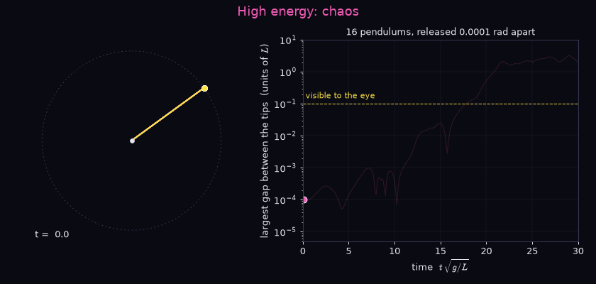
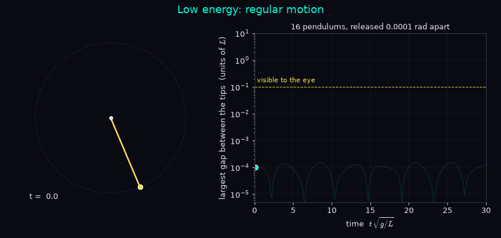
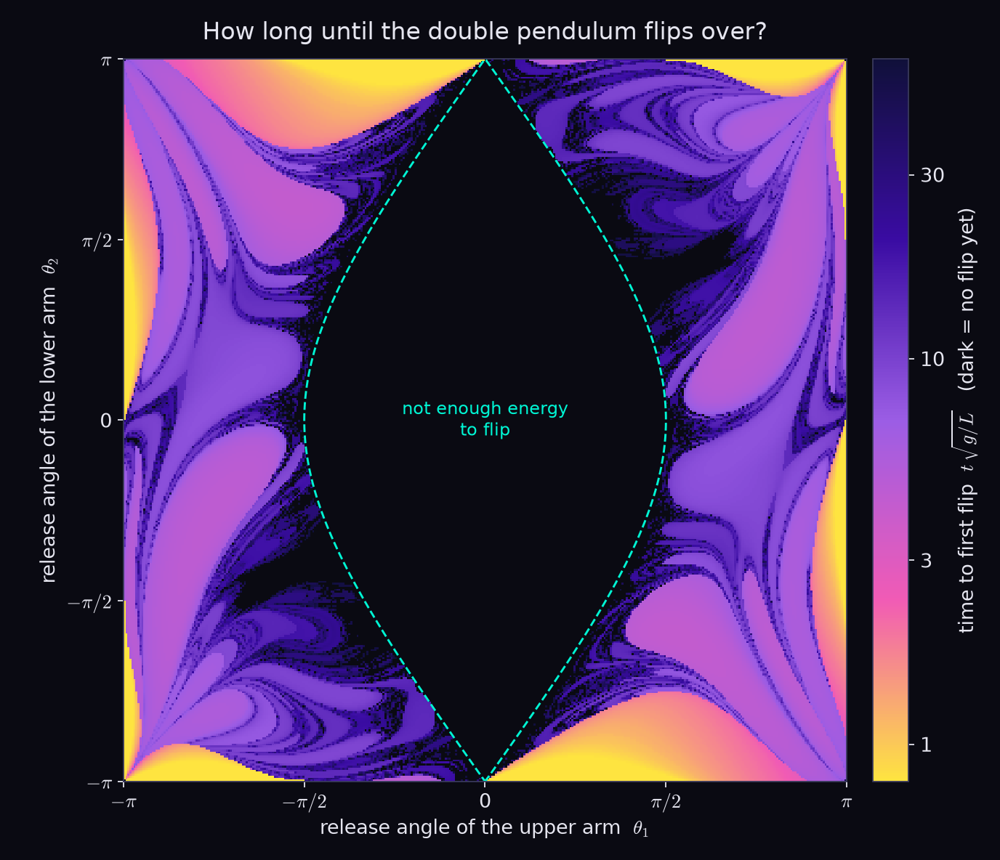
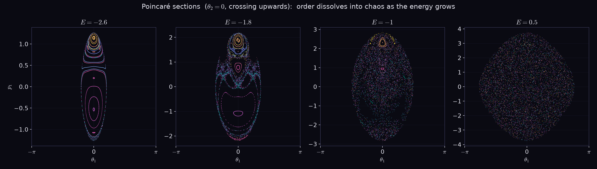
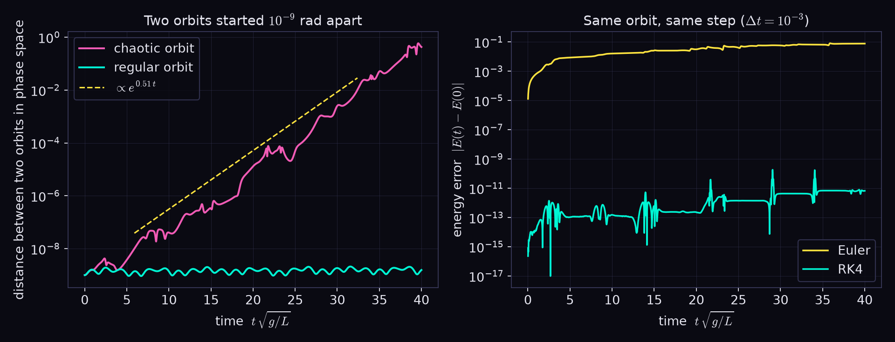

# Double pendulum: from order to chaos

### Sixteen pendulums, released 0.0001 rad apart

[](https://www.python.org/)
[](https://numpy.org/)
[](https://matplotlib.org/)
[](LICENSE)

<p align="center">
  
</p>

<sub><b>High energy.</b> Sixteen double pendulums start within 0.0001 rad of each other. For a while they move
as one. The gap between them grows exponentially (right, log scale), crosses the size the eye can see
around t ≈ 18, and after that every pendulum goes its own way.</sub>

<p align="center">
  
</p>

<sub><b>Low energy.</b> Same experiment, same axes, smaller release angle. The gap never grows: the sixteen
pendulums stay on top of each other. Same equations, different regime.</sub>

---

## The system

Two point masses $m_1, m_2$ on massless rigid rods $L_1, L_2$, with angles $\theta_1, \theta_2$ measured
from the downward vertical. The Lagrangian is $\mathcal{L} = T - V$ with

```math
T = \tfrac{1}{2}(m_1+m_2)L_1^2\dot\theta_1^2 + \tfrac{1}{2}m_2L_2^2\dot\theta_2^2
    + m_2L_1L_2\dot\theta_1\dot\theta_2\cos(\theta_1-\theta_2)
```

```math
V = -(m_1+m_2)gL_1\cos\theta_1 - m_2gL_2\cos\theta_2
```

The Euler–Lagrange equations, solved for the accelerations with $\Delta = \theta_1 - \theta_2$:

```math
\ddot\theta_1 = \frac{-g(2m_1+m_2)\sin\theta_1 - m_2g\sin(\theta_1-2\theta_2)
  - 2m_2\sin\Delta\left(\dot\theta_2^2L_2 + \dot\theta_1^2L_1\cos\Delta\right)}
  {L_1\left(2m_1+m_2-m_2\cos 2\Delta\right)}
```

```math
\ddot\theta_2 = \frac{2\sin\Delta\left(\dot\theta_1^2L_1(m_1+m_2) + g(m_1+m_2)\cos\theta_1
  + \dot\theta_2^2L_2m_2\cos\Delta\right)}
  {L_2\left(2m_1+m_2-m_2\cos 2\Delta\right)}
```

The code uses $m_1 = m_2 = L_1 = L_2 = g = 1$, so time is in units of $\sqrt{L/g}$ and energy in units
of $mgL$. The rest position has $E = -3$. There is no friction, so $E = T + V$ is conserved, and it is the
only parameter that decides how the system behaves.

## A map of the chaos

Release the pendulum from rest at every pair of angles $(\theta_1, \theta_2)$ and measure how long it
takes until either arm flips over the top. Each pixel is one simulation (129,600 in total).

<p align="center">
  
</p>

- **Smooth regions:** neighbouring release angles behave alike, so the motion is predictable.
- **Finely striped regions:** a tiny change in the release angle changes the outcome completely. That is
  the sensitivity seen in the animation.
- **Dark centre:** from rest, a flip is only possible if $2\cos\theta_1 + \cos\theta_2 \le 1$. Inside the
  dashed curve the pendulum does not have the energy to flip, ever. The curve is analytic and is
  drawn on top of the simulation, not fitted to it.

## Order dissolving into chaos

A Poincaré section reduces each orbit to the points where it crosses $\theta_2 = 0$ moving upwards,
plotted as $(\theta_1, p_1)$ with $p_1 = \partial\mathcal{L}/\partial\dot\theta_1$. All orbits in a panel
share the same energy; each colour is one orbit.

<p align="center">
  
</p>

| Energy | What the section shows |
|---|---|
| $E = -2.6$ | closed curves everywhere: every orbit is regular (quasi-periodic) |
| $E = -1.8$ | a band of scattered points appears between the surviving curves |
| $E = -1$ | a chaotic sea with a few regular islands left |
| $E = 0.5$ | no regular island is visible among the sampled orbits |

A regular orbit draws a curve because it is confined to a torus. A chaotic orbit fills an area.

## Measuring the chaos, and checking the integrator

<p align="center">
  
</p>

**Left:** two orbits started $10^{-9}$ rad apart. On the chaotic orbit their distance grows as
$e^{\lambda t}$ with $\lambda \approx 0.51$, nine orders of magnitude in 40 time units. On the regular
orbit it stays at its initial size. **Right:** energy error on the chaotic orbit with the same time
step: Euler drifts by 8 % of $mgL$, RK4 stays below $2\times10^{-10}$.

## Numerical method

Everything is integrated with a classic fourth-order Runge–Kutta scheme written by hand (`rk4_step`).
It is vectorised with NumPy over the initial conditions, so the 16 pendulums of the animation, the
112 orbits of the Poincaré sections and the 64,800 integrated pixels of the flip map (the other half
follows from the symmetry $(\theta_1,\theta_2)\to(-\theta_1,-\theta_2)$) each advance in a single call.

## Verification

```
Checks (m1 = m2 = L1 = L2 = g = 1)
  normal mode in-phase      T = 8.209378   exact = 8.209377   rel. error = 8.3e-08
  normal mode out-of-phase  T = 3.400442   exact = 3.400435   rel. error = 1.9e-06
  energy drift over t = 40 (dt = 0.001):  RK4 = 1.8e-10   Euler = 8.2e-02
  chaotic orbit: separation grows as exp(0.51 t)  (finite-time Lyapunov estimate, fitted on t = 5.9..32.4)
  regular orbit: separation after t = 40 is 2 x the initial one (no exponential growth)
  numerical horizon: runs with dt and dt/2 agree to 1e-3 until t = 41.3
  chaos.gif: the 16 tips are more than 0.1 L apart from t = 17.9
  flip map: 0 flips inside the energetically forbidden region (must be 0), 10.4 % of the allowed grid has not flipped by t = 60
  Poincare sections: max energy drift over t = 1500 is 2.0e-05
```

- **Normal modes.** For small oscillations the exact frequencies are $\omega^2 = (2 \mp \sqrt2)\,g/L$.
  The simulated periods match them.
- **Energy.** Conserved by RK4 on every run reported above.
- **Forbidden region.** No simulated pendulum flips where the energy argument says it cannot.

### What these numbers do and do not say

- **A chaotic path is only computable for a while.** Runs with step $\Delta t$ and $\Delta t/2$ agree
  until $t \approx 41$; the animation stops at $t = 30$, inside that window. Beyond it, a computed path
  is one plausible path, not *the* path. Statistical pictures such as the Poincaré sections do not
  depend on following a single path exactly.
- **$\lambda \approx 0.51$ is a finite-time estimate** from one pair of orbits at one energy
  ($E = 1.77$). It is not a converged Lyapunov exponent.
- **The flip map** uses a 360 × 360 grid, $\Delta t = 0.02$ and stops at $t = 60$. Its fine stripes are
  limited by that resolution; no convergence study was done for it. Dark pixels outside the dashed
  curve have not flipped *yet*.
- **"No regular island" at $E = 0.5$** refers to the 28 orbits sampled, not to a proof.
- **Model:** point masses, rigid massless rods, no friction, equal masses and lengths.

## Run it

```bash
pip install -r requirements.txt
python double_pendulum.py
```

It prints the checks and regenerates everything in `figures/` (about four minutes on a laptop). The
release angles are the constants `CHAOTIC` and `REGULAR` at the top of the file.

## Files

```
double_pendulum.py   # equations, RK4, checks, animations and figures
figures/             # chaos.gif, regular.gif, flip_map.png, poincare.png, diagnostics.png
requirements.txt     # numpy, matplotlib, pillow
LICENSE              # MIT
```

Related: [simple-pendulum-phase-portrait](https://github.com/danielparra2/simple-pendulum-phase-portrait),
the one-pendulum case, where chaos is impossible.

---

*Code: MIT. Written by Daniel Parra Parra, 2026.*
